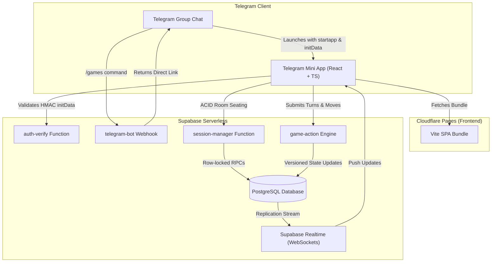
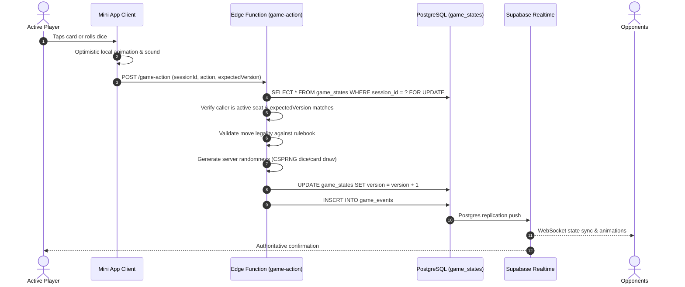

# നേരംപോക്ക് (NERAMPOKKU) — SYSTEM ARCHITECTURE & DATA FLOWS

> **Official Name:** നേരംപോക്ക്  
> **Tagline:** കളിക്കാം... സമയം പോക്കാം!  
> **Descriptor:** GAME BOT  

## 1. High-Level Overview

**നേരംപോക്ക്** is an authoritative multiplayer gaming platform built inside the Telegram Mini Apps ecosystem. The architecture is engineered around three primary tenets:
1. **Server-Authoritative Gameplay**: All moves, card draws, shuffles, dice rolls, and turn advancements occur on the backend to prevent cheating.
2. **Deterministic State Synchronization**: Updates are sequenced with monotonic version numbers.
3. **Zero-Friction Group Matchmaking**: Group members join active matches directly through Telegram deep links without typing room codes.

---

## 2. Component Breakdown

### Frontend (Cloudflare Pages)
- **Framework:** React 19, TypeScript (strict), Vite.
- **Styling:** Tailwind CSS with custom gaming theme (glassmorphism panels, glowing borders).
- **Animation:** Framer Motion for card slide/deal transitions, custom CSS keyframes.
- **Vector Graphics:** Custom SVG engines for UNO cards, 4-Player 15x15 board, and 6-Player Hexagonal board.
- **Audio & Haptics:** Pure Web Audio API synthesis (0 external audio files) + Telegram WebApp Haptic Feedback.

### Authoritative Backend (Supabase)
- **Edge Functions (Deno):**
  - `auth-verify`: Cryptographic verification of Telegram `initData` using `HMAC-SHA256`.
  - `telegram-bot`: Webhook handling Telegram commands `/start`, `/games`, `/help`, `/stats`, `/profile`.
  - `session-manager`: Group room lifecycle (create, join, leave, start).
  - `game-action`: Authoritative card playing, dice rolls, turn resolution.
- **PostgreSQL Database:** Normalized tables with row-level locks, foreign keys, indexes, and RLS policies.
- **Supabase Realtime:** Multiplexed WebSockets for room broadcasts, presence, and chat messages.

### Telegram Integration
- **Direct Links:** `https://t.me/<bot>/nerampokku?startapp=g_<chat_id>` deep-links directly into the group's match room.
- **Cryptographic Validation:** Validates `auth_date`, sorts parameter keys, calculates HMAC with `WebAppData` secret key.

---

## 3. Authoritative Turn Execution Pipeline

