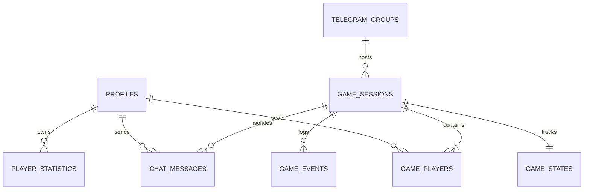

# GAMEVERSE — DATABASE SCHEMA & STORED PROCEDURES

## 1. Schema Overview

GAMEVERSE utilizes normalized PostgreSQL tables with strict foreign key constraints, indexes, and Row Level Security (RLS) policies.



---

## 2. Table Definitions

### 1. `profiles`
Stores verified Telegram user identities.
```sql
CREATE TABLE profiles (
    id UUID PRIMARY KEY DEFAULT gen_random_uuid(),
    telegram_id BIGINT UNIQUE NOT NULL,
    username TEXT,
    first_name TEXT NOT NULL,
    last_name TEXT,
    photo_url TEXT,
    created_at TIMESTAMPTZ NOT NULL DEFAULT NOW(),
    last_seen_at TIMESTAMPTZ NOT NULL DEFAULT NOW()
);
CREATE INDEX idx_profiles_telegram_id ON profiles(telegram_id);
```

### 2. `telegram_groups`
Stores verified Telegram group chat metadata.
```sql
CREATE TABLE telegram_groups (
    id UUID PRIMARY KEY DEFAULT gen_random_uuid(),
    telegram_chat_id BIGINT UNIQUE NOT NULL,
    title TEXT NOT NULL,
    chat_type TEXT NOT NULL DEFAULT 'group',
    created_at TIMESTAMPTZ NOT NULL DEFAULT NOW(),
    updated_at TIMESTAMPTZ NOT NULL DEFAULT NOW()
);
CREATE INDEX idx_telegram_groups_chat_id ON telegram_groups(telegram_chat_id);
```

### 3. `game_sessions`
Represents an individual multiplayer match room.
```sql
CREATE TABLE game_sessions (
    id UUID PRIMARY KEY DEFAULT gen_random_uuid(),
    group_id UUID NOT NULL REFERENCES telegram_groups(id) ON DELETE CASCADE,
    game_type game_type_enum NOT NULL, -- 'uno' | 'ludo'
    status session_status_enum NOT NULL DEFAULT 'waiting', -- 'waiting' | 'in_progress' | 'completed' | 'abandoned'
    host_id UUID NOT NULL REFERENCES profiles(id) ON DELETE CASCADE,
    min_players INT NOT NULL DEFAULT 2,
    max_players INT NOT NULL,
    current_player_count INT NOT NULL DEFAULT 1,
    created_at TIMESTAMPTZ NOT NULL DEFAULT NOW(),
    started_at TIMESTAMPTZ,
    ended_at TIMESTAMPTZ
);
```

### 4. `game_players`
Maps players to specific numbered seats (0 to N-1) inside a session.
```sql
CREATE TABLE game_players (
    id UUID PRIMARY KEY DEFAULT gen_random_uuid(),
    session_id UUID NOT NULL REFERENCES game_sessions(id) ON DELETE CASCADE,
    profile_id UUID NOT NULL REFERENCES profiles(id) ON DELETE CASCADE,
    seat_index INT NOT NULL CHECK (seat_index >= 0 AND seat_index < 6),
    status player_status_enum NOT NULL DEFAULT 'waiting',
    joined_at TIMESTAMPTZ NOT NULL DEFAULT NOW(),
    last_heartbeat TIMESTAMPTZ NOT NULL DEFAULT NOW(),
    CONSTRAINT uq_session_profile UNIQUE (session_id, profile_id),
    CONSTRAINT uq_session_seat UNIQUE (session_id, seat_index)
);
```

### 5. `game_states`
Authoritative snapshot of active match state.
```sql
CREATE TABLE game_states (
    session_id UUID PRIMARY KEY REFERENCES game_sessions(id) ON DELETE CASCADE,
    version INT NOT NULL DEFAULT 1,
    current_turn_seat INT NOT NULL DEFAULT 0,
    turn_direction INT NOT NULL DEFAULT 1,
    turn_deadline TIMESTAMPTZ,
    public_state JSONB NOT NULL DEFAULT '{}'::jsonb,
    private_hands JSONB NOT NULL DEFAULT '{}'::jsonb,
    winner_seat INT,
    updated_at TIMESTAMPTZ NOT NULL DEFAULT NOW()
);
```

### 6. `chat_messages` & `chat_reactions`
Per-match isolated real-time text chat and emoji reactions.
```sql
CREATE TABLE chat_messages (
    id UUID PRIMARY KEY DEFAULT gen_random_uuid(),
    session_id UUID NOT NULL REFERENCES game_sessions(id) ON DELETE CASCADE,
    sender_id UUID NOT NULL REFERENCES profiles(id) ON DELETE CASCADE,
    content VARCHAR(280) NOT NULL,
    created_at TIMESTAMPTZ NOT NULL DEFAULT NOW()
);

CREATE TABLE chat_reactions (
    id UUID PRIMARY KEY DEFAULT gen_random_uuid(),
    message_id UUID NOT NULL REFERENCES chat_messages(id) ON DELETE CASCADE,
    user_id UUID NOT NULL REFERENCES profiles(id) ON DELETE CASCADE,
    emoji VARCHAR(16) NOT NULL,
    created_at TIMESTAMPTZ NOT NULL DEFAULT NOW(),
    CONSTRAINT uq_message_user_emoji UNIQUE (message_id, user_id, emoji)
);
```

### 7. `player_statistics`
Persistent win/loss leaderboards.
```sql
CREATE TABLE player_statistics (
    id UUID PRIMARY KEY DEFAULT gen_random_uuid(),
    profile_id UUID NOT NULL REFERENCES profiles(id) ON DELETE CASCADE,
    game_type game_type_enum NOT NULL,
    matches_played INT NOT NULL DEFAULT 0,
    wins INT NOT NULL DEFAULT 0,
    losses INT NOT NULL DEFAULT 0,
    win_rate NUMERIC(5,2) GENERATED ALWAYS AS (
        CASE WHEN matches_played > 0 THEN ROUND((wins::numeric / matches_played::numeric) * 100, 2) ELSE 0 END
    ) STORED,
    updated_at TIMESTAMPTZ NOT NULL DEFAULT NOW(),
    CONSTRAINT uq_profile_gametype UNIQUE (profile_id, game_type)
);
```

---

## 3. Stored Procedures & Atomic Functions

- `join_game_session(p_session_id, p_profile_id)`:
  - Uses `SELECT ... FOR UPDATE` row locking.
  - Verifies session is in `waiting` status.
  - Verifies capacity has not been exceeded.
  - Assigns the lowest available integer seat index.
- `leave_game_session(p_session_id, p_profile_id)`:
  - Frees the seat.
  - Reassigns host to the oldest joined player if host leaves.
  - Dissolves session if 0 players remain.
- `start_game_session(p_session_id, p_profile_id)`:
  - Validates caller is host and player count $\ge$ min_players.
- `record_match_result(p_session_id, p_winner_profile_id, p_game_type)`:
  - Marks match completed and atomically updates winner and loser stats in `player_statistics`.
